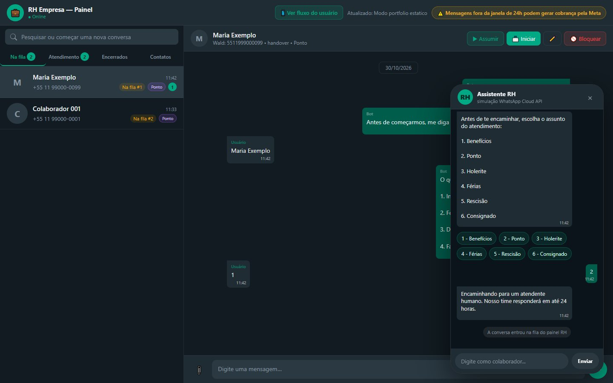

# Bot RH Meta

Chatbot de RH no WhatsApp, integrado à API oficial da Meta. O robô resolve dúvidas de ponto, folha e benefícios com tutoriais passo a passo; quando a pessoa precisa de atendimento humano, a conversa entra numa fila que o RH atende num painel web parecido com o WhatsApp Web.

**[Ler o estudo de caso](https://lariantunez.github.io/Bot-RH-Meta-Painel/)** · **[Abrir a demo do painel](https://lariantunez.github.io/Bot-RH-Meta-Painel/painel/)**



> **Versão de portfólio.** O bot original roda em produção na empresa. Esta versão traz o painel com conversas fictícias e uma cópia sanitizada do backend, sem tokens, senhas ou contatos reais.

## O problema

Boa parte das perguntas que chegam ao RH pelo WhatsApp se repete todo dia (como bater o ponto, onde ver o espelho, como enviar um atestado) e tem resposta conhecida. A outra parte precisa de alguém olhando o caso. As duas chegavam misturadas, no mesmo número.

## O que eu construí

- **Máquina de estados com 14 estados** por número de WhatsApp. A mesma resposta "1" significa coisas diferentes conforme o ponto da conversa.
- **Menus e 10 tutoriais** com passo a passo e vídeo curto para cada tarefa.
- **Fila de atendimento humano** com 6 assuntos para etiquetar o chamado e aviso por e-mail ao RH a cada novo chamado.
- **Painel do RH** com abas (na fila, em atendimento, encerrados, contatos), envio de texto e anexos, caixa de texto que cresce com a mensagem (como no WhatsApp) e atualização em tempo real.
- **Regras contra becos sem saída:** resgate de contexto, encerramento por inatividade de 3 minutos e bloqueio de contatos.

## Decisões técnicas

- **Quando o RH assume, o bot fica em silêncio:** no estado `manual`, o webhook só registra a mensagem.
- **Limite de envio da Meta** (erro #131056): uma fila de promessas por destinatário, com intervalo mínimo de 900 ms e nova tentativa.
- **O painel sobrevive a um reinício:** mensagens, contatos e bloqueios ficam no MongoDB, e o status de cada conversa é deduzido das mensagens ao subir o servidor.
- O webhook responde 200 mesmo em caso de erro, para a Meta não reenviar a mesma mensagem.

## Stack

Node.js · Express · WhatsApp Cloud API (Graph API v22.0) · MongoDB Atlas · Server-Sent Events · Nodemailer · HTML, CSS e JavaScript puro no painel

## Estrutura

| Caminho | Conteúdo |
|---|---|
| `index.html` e `assets/` | Estudo de caso em 9 capítulos |
| `painel/index.html` | Painel do RH com conversas fictícias e simulação do WhatsApp do colaborador |
| `codigo-original/index-original-sanitizado.js` | Backend original (webhook, máquina de estados, fila e API do painel), sem credenciais |

## Rodar localmente

```bash
npx serve .
```

---

**🇺🇸 English:** an HR chatbot on WhatsApp, built on Meta's official Cloud API. It answers time-tracking, payroll and benefits questions with step-by-step tutorials, and routes people who need a human into a queue that HR handles in a WhatsApp Web-style panel. Highlights: a 14-state conversation machine, a per-recipient send queue to respect Meta's rate limits, a real-time panel via Server-Sent Events and MongoDB persistence. Stack: Node.js, Express, MongoDB Atlas. Portfolio version with fictional conversations and a sanitized backend; the original runs in production.
